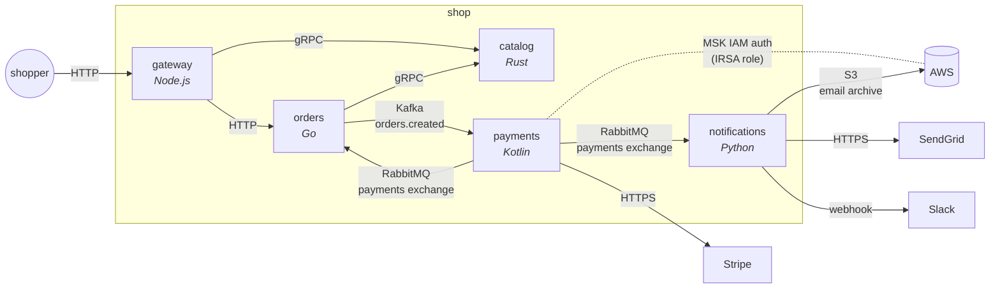
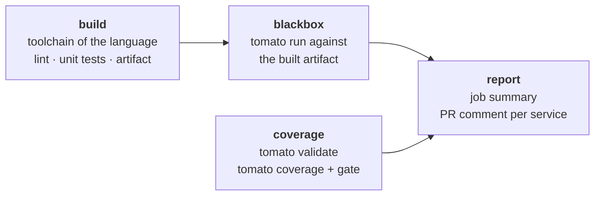

# 🍅 tomato demo: one shop, five languages

A small shop built as five microservices, each in a different language,
talking to each other over **HTTP, gRPC, Kafka and RabbitMQ**, with **AWS**
(S3, MSK with IAM auth) and the third parties most services end up
integrating (**Stripe, SendGrid, Slack**).

Every service is tested the same way, whatever it is written in: as a
**black box** with [tomato](https://github.com/tomatool/tomato). The suite
starts the service's real dependencies, stands in for the services it calls,
and talks to it only the way the rest of the system does. No test imports a
line of the service's code, so the same kind of suite tests Go, Rust, Kotlin,
Python and Node.js.

## The shop



| Service | Language | Owns | Serves | Calls |
|---|---|---|---|---|
| [gateway](services/gateway) | Node.js | — | the public HTTP API, behind an API key | catalog (gRPC), orders (HTTP) |
| [orders](services/orders) | Go | orders (Postgres) | HTTP | catalog (gRPC); publishes `orders.created` (Kafka); follows `payment.*` (RabbitMQ) |
| [catalog](services/catalog) | Rust | products, stock (Postgres) | gRPC, with reflection | — |
| [payments](services/payments) | Kotlin | — | — | consumes `orders.created` from Kafka **with MSK IAM auth**; charges with **Stripe** (its Java SDK); publishes `payment.*` (RabbitMQ) |
| [notifications](services/notifications) | Python | notifications (Postgres) | HTTP | consumes `payment.*` (RabbitMQ); emails with **SendGrid**, alerts **Slack**, archives to **S3** |

An order goes through all of them: gateway → orders, which reserves stock in
catalog over gRPC and announces the order on Kafka → payments charges it with
Stripe and publishes the outcome on RabbitMQ → orders marks the order paid,
and notifications emails the customer and archives the email.

## How a black-box suite works

Each service has a `tomato.yml` and a `features/` directory next to its code.
Take [orders](services/orders/tomato.yml):

```yaml
containers:          # its real dependencies, started fresh for the run
  postgres: { image: postgres:16-alpine, ... }
  kafka:    { preset: kafka }
  rabbitmq: { image: rabbitmq:3-alpine, ... }

app:                 # the service itself: the binary the build job produced
  command: ./bin/orders
  env:
    CATALOG_ADDR: "{{.catalog.address}}"      # ← the stub below
    KAFKA_BROKERS: "{{.kafka.host}}:{{.kafka.port.9092}}"

resources:           # how the suite reaches it, and stands in for its neighbours
  api:     { type: http, base_url: http://localhost:8080 }
  catalog: { type: grpc-server, options: { descriptor_set: ../../proto/catalog.binpb } }
  db:      { type: postgres, container: postgres }
  events:  { type: kafka, container: kafka }
```

and a scenario reads like the behaviour it checks, including the effects
other services see, not only the response:

```gherkin
Scenario: An order is priced, reserved, stored and announced
  Given "catalog" stub "catalog.v1.CatalogService/GetProduct" returns json: ...
  When "api" sends "POST" to "/orders" with json: ...
  Then "api" response status is "201"
  And "catalog" received "catalog.v1.CatalogService/ReserveStock" "2" times
  And "db" table "order_items" has "2" rows
  And "events" receives from "orders.created" within "10s"
```

What each suite does:

| Suite | tomato starts | tomato stands in for | Scenarios check |
|---|---|---|---|
| [gateway](services/gateway/features) | — | orders (HTTP stub), catalog (gRPC stub) | API keys, price formatting, request ids, timeouts, outages, 20 concurrent shoppers |
| [orders](services/orders/features) | Postgres, Kafka, RabbitMQ | catalog (gRPC stub) | pricing and reserving, the stored order, the Kafka event and its headers, unknown products, out of stock, catalog down, payment events changing the status |
| [catalog](services/catalog/features) | Postgres | — | reflection, reading and listing products, reserving stock, refusing what the stock cannot cover |
| [payments](services/payments/features) | Kafka **with an MSK IAM listener**, RabbitMQ, **STS** (IRSA) | Stripe (HTTP stub) | the PaymentIntent sent to Stripe, declines, retries with one idempotency key, Stripe down, poison messages; that it signs in to Kafka as its own IAM role |
| [notifications](services/notifications/features) | Postgres, RabbitMQ, **S3** (MinIO) | SendGrid, Slack (HTTP stubs) | the SendGrid request, Slack alerts, the S3 archive, duplicate events, retries, refused addresses |
| [e2e](e2e) | all five services, built from their Dockerfiles, plus their infrastructure | Stripe, SendGrid, Slack (WireMock) | a paid order, a declined one, one the stock cannot cover, end to end |

tomato resets every resource before every scenario (tables truncated, queues
purged, stubs cleared), so scenarios do not depend on each other.

## The pipelines

Every service has its own workflow ([gateway](.github/workflows/gateway.yml),
[orders](.github/workflows/orders.yml), [catalog](.github/workflows/catalog.yml),
[payments](.github/workflows/payments.yml),
[notifications](.github/workflows/notifications.yml)), triggered only by changes
to that service, and all of the same shape:



- **build** is the only language-specific job: `npm test`, `go test`,
  `cargo clippy` + `cargo test`, `gradle test`, `pytest`. It hands the built
  artifact on, so the black-box suite tests exactly what was built.
- **coverage** needs neither the build nor Docker, so it runs alongside it.
  `tomato validate` checks the suite, and `tomato coverage` reports how much of
  each declared resource's step vocabulary the scenarios use. It fails when a
  step matches no step definition (a typo), or when the total drops below the
  service's floor (`min-total` in its workflow), so coverage cannot quietly
  shrink.
- **blackbox** installs tomato and runs the suite; tomato starts the
  containers on the runner's Docker. JUnit results and every container's and
  the app's logs are kept as artifacts.
- **report** puts the results and the coverage table in the job summary and,
  on a pull request, in one comment per service, updated on every push.

The [e2e](.github/workflows/e2e.yml) workflow runs the whole shop on any
change. The pieces are shared: [setup-tomato](.github/actions/setup-tomato),
[tomato-blackbox](.github/actions/tomato-blackbox),
[tomato-report](.github/actions/tomato-report) and the reusable
[tomato-coverage](.github/workflows/tomato-coverage.yml) workflow.

## Running it locally

You need Docker, [tomato](https://github.com/tomatool/tomato#installation)
and the toolchain of the service you work on.

```bash
make orders          # build orders and run its suite
make payments        # ... or any other service
make e2e             # the whole shop
make coverage        # step coverage of every suite
tomato ui            # in a service directory: watch scenarios run
```

## Notes on the suites

A few choices in the suites work around current tomato behaviour, and say so
where they do:

- **Kafka and RabbitMQ message assertions compare text** (`last message
  contains`), and do not substitute saved `{{variables}}`. The suites check
  fragments of the JSON the services write.
- **payments' topic is not reset by tomato.** tomato resets Kafka topics by
  deleting and recreating them, which restarts their offsets under a consumer
  that keeps running. payments creates its topic itself, and each scenario uses
  its own order ids.
- **payments' suite declares a queue per scenario.** tomato's RabbitMQ
  consumer from one scenario stays subscribed into the next, and takes its
  share of the messages.
- **WireMock is reset by the e2e scenarios themselves**, as tomato does not
  manage it.
